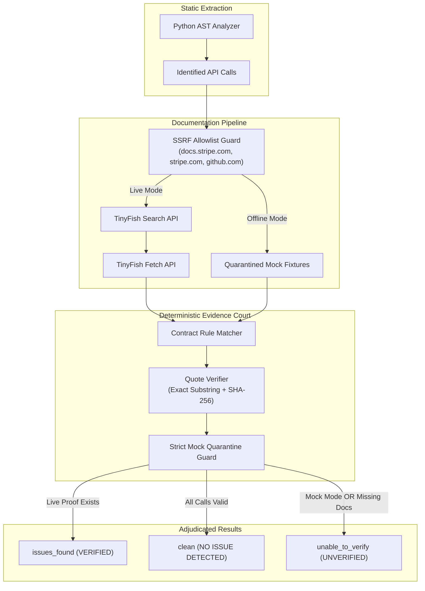

# APICompass

> **Evidence-Based API Contract Verification for Modern Developers**  
> Identifies deprecated or unsupported API calls, validates findings against official documentation using exact quote verification, proposes evidence-gated fixes, and transparently abstains when evidence is insufficient.

**Core Invariant**: *The model proposes; deterministic code decides which claims can be displayed as verified.*


## 1. Executive Summary & Problem Statement

### The Problem
Modern applications rely heavily on rapidly changing third-party APIs (payment processors, cloud platforms, communication APIs). When integrating these services, developers face four critical challenges:
1. **API Drift & Breaking Changes**: SDKs evolve continuously. Methods and parameters are deprecated or altered between versions, leading to silent failures in production.
2. **Hallucinating AI Code Assistants**: Traditional generative AI linters invent non-existent parameters, hallucinate SDK features, or report confident false alarms.
3. **Black-Box Traditional Linters**: Tools like Flake8, Ruff, and Pylint inspect syntax and style, but have zero awareness of upstream documentation or API contract changes.
4. **Context Switching & Tab Fatigue**: Engineers spend hours cross-referencing documentation tabs to confirm whether an API argument is truly supported.

### What APICompass Does
APICompass is an **evidence-based contract verification engine** for Python API usage:
- **Zero-Execution Static AST**: Parses Python source code using the standard library `ast` module. Code is **never executed, imported, or run in any runtime environment**.
- **Live Documentation Retrieval via TinyFish**: Queries official API documentation using **TinyFish Search** and retrieves normalized, structured documentation using **TinyFish Fetch**.
- **Deterministic Evidence Court**: Verifies every finding against exact quotes from retrieved documentation using exact string matching and **SHA-256 fingerprinting**.
- **Evidence-Gated Fix Proposals**: Generates actionable code diffs that developers can review and apply with a single click.
- **Strict Mock Quarantine**: Operates fully offline without internet or API keys using local mock fixtures. Mock findings are quarantined with amber badges and an `unable_to_verify` verdict so mock data never masquerades as verified truth.

---

## 2. 30-Second Demonstration Walkthrough

Try APICompass in 4 simple steps:

### Step 1: Open the Application
Navigate to `http://localhost:5173` in your browser (or follow [Local Setup](#7-local-development-setup) / [Docker Setup](#8-docker--container-setup)).

### Step 2: Paste a Legacy API Call
In the Monaco editor, paste the following legacy Stripe snippet:

```python
import stripe

def process_checkout(token: str, amount_cents: int):
    # Uses deprecated 'source' argument and legacy Charge endpoint
    return stripe.Charge.create(
        amount=amount_cents,
        currency="usd",
        source=token,
        description="Demo checkout"
    )
```

### Step 3: Click "Start Analysis"
Click the **"Start Analysis"** button. The server-sent events (SSE) progress bar streams real-time stages:
`Parsing AST` ➔ `Identifying Calls` ➔ `Retrieving Documentation` ➔ `Adjudicating Evidence`.

### Step 4: Review Findings & Apply the Fix
- **Finding Card**: Displays `Legacy Deprecated Parameter: Source Parameter Support` with location `Line 5, Col 11`.
- **Verified Official Excerpt**: Shows the exact quote from `docs.stripe.com` confirming `source` is deprecated in favor of `PaymentIntent`.
- **Canonical Doc Link**: Click the link to view the upstream Stripe reference directly.
- **Proposed Fix Diff**: Displays an inline side-by-side diff migrating to modern `stripe.PaymentIntent.create`. Click **"Apply Proposed Fix"** to update your editor code automatically.

---

## 3. How APICompass Analyzes Python API Usage

APICompass uses a strict, safe static analysis pipeline that guarantees security and deterministic output:

```
┌───────────────────────────────┐
│ User Python Source (Text)     │
└──────────────┬────────────────┘
               │ ast.parse() (ZERO EXECUTION: No eval(), No exec(), No subprocess)
               ▼
┌───────────────────────────────┐
│ Abstract Syntax Tree (AST)    │
└──────────────┬────────────────┘
               │ Visitor & Receiver Resolver
               ▼
┌───────────────────────────────┐
│ Identified API Calls          │ ──> e.g. stripe.Charge.create(amount=..., source=...)
└──────────────┬────────────────┘     - Receiver: stripe.Charge
               │                      - Method: create
               ▼                      - Positional & Keyword Arguments
┌───────────────────────────────┐     - Line & Column Coordinates
│ Security Allowlist & SSRF     │
└───────────────────────────────┘
```

### Zero-Execution Security Guarantee
APICompass parses submitted Python code **strictly as data** using Python's built-in `ast.parse` and passive AST visitors (`ast.walk`).
- **No `eval()` or `exec()`**: User code is never executed.
- **No Dynamic Imports**: Code is never imported into the Python runtime.
- **No Subprocesses**: No shell or interpreter processes are spawned to run user scripts.
- **Syntactic Robustness**: Handles invalid syntax gracefully with clear error messages and exact line/column indicators.

---

## 4. Documentation Pipeline & Evidence Validation



### The 4-Stage Evidence Pipeline:
1. **SSRF Guard & Allowlist**: Every destination URL is strictly checked against `APPROVED_DOC_HOSTS` (`docs.stripe.com`, `stripe.com`, `github.com/stripe/stripe-python`). Private IP addresses and malicious redirects are blocked immediately.
2. **TinyFish Ingestion**: TinyFish Search discovers canonical documentation pages, and TinyFish Fetch retrieves clean, normalized markdown content.
3. **Contract Matching**: The parameters detected in the user's AST call are matched against documented contract rules (required parameters, deprecated arguments, invalid types).
4. **Exact Quote Verification**: The Evidence Court locates the claimed rule in the retrieved documentation text, validates it via exact substring matching, and produces a SHA-256 integrity hash. Claims that cannot be substantiated by an exact quote are discarded.

---

## 5. Deterministic Code vs Optional LLM Suggestions

> **The APICompass Invariant**: *"The model proposes; deterministic code decides which claims can be displayed as verified."*

APICompass enforces an absolute boundary between deterministic validation logic and generative AI:

| Dimension | Deterministic Engine (Pure Code) | Optional LLM Reasoning |
| :--- | :--- | :--- |
| **Component** | Static AST Parser, Contract Matcher, Quote Verifier | GPT-4o-mini / Simulated Provider |
| **Role** | Evaluates code rules and verifies documentation quotes | Suggests candidate hypotheses and friendly summaries |
| **Authority** | **Sole authority** to emit a `VERIFIED` finding badge | **Zero authority**; cannot verify or certify any finding |
| **Execution** | Always active (local, instantaneous, zero cost) | Optional (default disabled: `LLM_PROVIDER=disabled`) |
| **UI Presentation** | Green `VERIFIED` badge with exact quote and SHA-256 hash | Amber `AI suggestion — not verified` label |
| **Hallucination Risk** | **0%** (mathematically verified against documentation text) | Quarantined; suppressed if conflicting with evidence |

---

## 6. Supported Capabilities & Known Limitations

### Supported Scope
- **Languages**: Python 3.11, 3.12, 3.13, and 3.14.
- **Ecosystem**: Stripe Python SDK (`stripe.*` endpoints, including `stripe.PaymentIntent.create`, `stripe.Charge.create`, `stripe.Customer.create`, `stripe.Refund.create`, and associated methods).
- **Project Structure**:
  - Single-file code snippets (Monaco editor).
  - Multi-file projects ($\le 20$ files, $\le 500$ KB total size).
- **Transport**: Real-time Server-Sent Events (SSE) streaming updates and JSON REST endpoints.
- **Persistence**: SQLite 3 audit database with SHA-256 source fingerprinting and zero raw source code retention.

### Documented Limitations
- **Dynamic `**kwargs`**: Dynamic runtime parameters (e.g., `stripe.Charge.create(**get_dynamic_args())`) cannot be resolved statically and are safely categorized as `unable_to_verify`.
- **Runtime Reflection / Monkey-Patching**: Modifying SDK methods at runtime cannot be observed via static AST analysis.
- **Non-Stripe Libraries**: Libraries outside the supported Stripe scope (e.g., AWS, Twilio, OpenAI) are recognized as out-of-scope and cleanly abstained from rather than reporting false violations.
- **In-Memory Rate Limiting**: The built-in rate limiter runs in-process. High-throughput distributed deployments should attach Redis.

---

## 7. Local Development Setup

### Prerequisites
- **Python**: 3.11, 3.12, 3.13, or 3.14
- **Node.js**: 18.x, 20.x, or 22+
- **npm**: 9+
- **Git**

### Step-by-Step Installation

```bash
# 1. Clone the repository
git clone https://github.com/shivampathak890/APICompass.git
cd APICompass

# 2. Setup Python virtual environment
python3 -m venv .venv
./.venv/bin/pip install --upgrade pip
./.venv/bin/pip install -r backend/requirements.txt -r backend/requirements-dev.txt

# 3. Setup Frontend dependencies
cd frontend
npm ci
cd ..

# 4. Create local environment configuration
cp .env.example .env
```

*(Windows users: use `python -m venv .venv`, `.\.venv\Scripts\pip.exe install ...`, and `Copy-Item .env.example .env`)*.

### Starting the Servers

**Terminal 1 — Backend API Server**:
```bash
./.venv/bin/python -m uvicorn app.main:create_app --factory --app-dir backend --host 127.0.0.1 --port 8000 --reload
```
- Health Check: `http://127.0.0.1:8000/api/v1/health`
- Interactive OpenAPI Docs: `http://127.0.0.1:8000/docs`

**Terminal 2 — Frontend Development Server**:
```bash
cd frontend
npm run dev -- --host 127.0.0.1 --port 5173
```
- Web Application: `http://localhost:5173`

---

## 8. Docker & Container Setup

APICompass provides a complete, multi-container Docker Compose configuration for one-command startup without installing local Python or Node dependencies.

### Start the Stack (Offline Mock Mode by Default)
```bash
docker compose up --build -d
```

- **Backend API**: `http://localhost:8000`
- **Frontend UI**: `http://localhost:5173`
- **SQLite Database**: Stored in `./data/apicompass.db` on your host machine via volume mount.

### Start with Live TinyFish Ingestion
```bash
MOCK_MODE=false TINYFISH_API_KEY=your_key_here docker compose up --build -d
```

### Container Verification & Logs
```bash
# Check container health status
docker compose ps

# Follow backend logs
docker compose logs -f backend

# Clean shutdown (preserves SQLite data on host)
docker compose down
```

For full details on non-root execution, Docker security, and networking, see the **[Docker Guide](docs/DOCKER.md)**.

---

## 9. Environment Configuration

All settings are configured via `.env` in the repository root (see `.env.example`):

| Variable | Default Value | Description |
| :--- | :--- | :--- |
| `APP_ENV` | `development` | Runtime environment (`development`, `testing`, `production`) |
| `MOCK_MODE` | `true` | `true` for offline mock fixtures; `false` for live TinyFish retrieval |
| `API_HOST` | `127.0.0.1` | Local backend bind address |
| `API_PORT` | `8000` | Local backend port |
| `FRONTEND_ORIGIN` | `http://localhost:5173` | Allowed CORS origin (strict security; no wildcards) |
| `APPROVED_DOC_HOSTS` | `stripe.com,docs.stripe.com,github.com` | SSRF destination domain allowlist |
| `TINYFISH_API_KEY` | *(empty)* | TinyFish API key (required only when `MOCK_MODE=false`) |
| `TINYFISH_SEARCH_BASE_URL` | `https://api.search.tinyfish.ai` | TinyFish Search API endpoint |
| `TINYFISH_FETCH_BASE_URL` | `https://api.fetch.tinyfish.ai` | TinyFish Fetch API endpoint |
| `DOC_RETRIEVAL_TIMEOUT_SECONDS` | `15.0` | Timeout per external documentation request |
| `DOC_CIRCUIT_BREAKER_FAILURES` | `3` | Consecutive failures before opening the circuit breaker |
| `LLM_PROVIDER` | `disabled` | AI reasoning provider (`disabled`, `mock`, `openai`) |
| `APICOMPASS_DB_PATH` | `data/apicompass.db` | Path to persistent SQLite audit database |
| `SOURCE_RETENTION_ENABLED` | `false` | **Privacy Guard**: Raw user source code is never saved |

> [!IMPORTANT]
> Real API keys should never be committed to git. `.env` is listed in `.gitignore` and `.dockerignore`.

---

## 10. Offline Mock Mode vs Live TinyFish Mode

APICompass is designed to be 100% functional during hackathons, flights, or venue internet drops:

| Feature | Offline Mock Mode (`MOCK_MODE=true`) | Live Mode (`MOCK_MODE=false`) |
| :--- | :--- | :--- |
| **Internet Access** | Not required (100% offline) | Required |
| **API Key Needed** | None | `TINYFISH_API_KEY` |
| **Header / Footer Badge** | `Mock Mode Active (Offline Fixtures)` (Amber) | `Live Documentation Retrieval` (Green) |
| **Finding Card Badge** | `MOCK QUARANTINE (UNVERIFIED)` (Amber) | `VERIFIED` (Green Checkmark) |
| **Adjudication Verdict** | Quarantined to `unable_to_verify` | `issues_found` or `clean` |
| **Fix Proposals** | Labeled as `mock_evidence_only` | Labeled as `evidence_supported` |
| **Upstream Outage Handling** | Immune to external network failure | Automatic circuit breaker fallback |

---

## 11. Verification & Test Execution

Every claim, parser rule, security control, and E2E workflow is verified by our automated regression suite:

```bash
# 1. Full Backend Regression Suite (697 collected)
./.venv/bin/pytest -m "not live_smoke" -q
# Result: 694 passed, 3 skipped in ~27s

# 2. Dedicated Security Audit & Hardening Matrix (47 tests)
./.venv/bin/pytest backend/tests/test_security_audit.py backend/tests/test_detection_rules_matrix.py -q
# Result: 47 passed (SSRF, CWE-117 safe filenames, AST zero-exec, contract rules)

# 3. Curated Benchmark Evaluation Dataset (26 cases, EVAL-01 to EVAL-26)
PYTHONPATH=backend ./.venv/bin/python -m evaluation.runner
# Result: 26/26 passed (100.0% accuracy, 1.0 F1 score, 4.2ms avg latency)

# 4. Frontend Production Build & TypeScript Verification
npm --prefix frontend run build
# Result: Clean build with 0 TypeScript errors across 2,846 modules

# 5. Playwright Browser End-to-End Suite (58 tests across 7 spec suites)
npm --prefix frontend run test:e2e
# Result: 58 passed across Chromium (primary journey, transparency, findings, project, sse)
```

For detailed benchmark metrics and precision/recall analysis, see **[BENCHMARK_REPORT.md](BENCHMARK_REPORT.md)** and **[INTEGRATION_TESTING_REPORT.md](INTEGRATION_TESTING_REPORT.md)**.

---

## 12. Privacy & Source-Code Retention Behavior

APICompass is built with enterprise privacy and data protection principles:
1. **Zero Raw Source Code Storage**: By default, `SOURCE_RETENTION_ENABLED=false`. The application **never writes submitted Python source code to disk or the database**.
2. **Cryptographic Fingerprinting**: The SQLite audit database (`data/apicompass.db`) stores only a one-way `source_sha256` hash and byte length for deduplication and audit trail verification.
3. **Secret Scrubbing**: All text fields stored in database logs or sent to external services pass through `scrub_secrets()`, automatically redacting Stripe keys (`sk_live_...`, `rk_live_...`), OpenAI keys (`sk-...`), and passwords.
4. **SQL Injection Immunity**: All database queries use strict parameterized SQLite queries without dynamic string formatting.

---

## 13. Troubleshooting Common Errors

### 1. Port 8000 or 5173 Already in Use
**Symptom**: `ERROR: [Errno 98] address already in use` or Vite error `Port 5173 is in use`.  
**Solution**: Another process is occupying the port. Find and stop it:
```bash
# Check what is using port 8000 / 5173
lsof -i :8000
lsof -i :5173
# Or specify alternative ports:
./.venv/bin/python -m uvicorn app.main:create_app --factory --app-dir backend --port 8001
cd frontend && npm run dev -- --port 5174
```

### 2. "Why are my findings marked MOCK QUARANTINE (UNVERIFIED)?"
**Explanation**: This is an intentional security feature. When running in offline mode (`MOCK_MODE=true`), APICompass quarantines mock findings to `unable_to_verify` so offline fixtures are never misrepresented as verified truth.  
**To enable live verification**: Set `MOCK_MODE=false` and supply your `TINYFISH_API_KEY` in `.env`.

### 3. Missing Credentials in Live Mode
**Symptom**: Status card displays `Missing Credentials` or API returns `400 Bad Request: TINYFISH_API_KEY is required in live mode`.  
**Solution**: Either add a valid `TINYFISH_API_KEY=...` to `.env` or toggle back to offline mode: `MOCK_MODE=true`.

### 4. Database Busy or Locked
**Symptom**: `sqlite3.OperationalError: database is locked`.  
**Solution**: Remove stale write-ahead log files or check permissions:
```bash
rm -f data/apicompass.db-wal data/apicompass.db-shm
```

---

## 14. Documentation Index

For deep-dive documentation on specific subsystems, consult the technical guides in `docs/`:

| Document | Purpose |
| :--- | :--- |
| **[Hackathon Demonstration Runbook](docs/DEMONSTRATION_RUNBOOK.md)** | Live demonstration script, scenarios, and presentation talking points |
| **[Docker & Containerization Guide](docs/DOCKER.md)** | Multi-container Docker Compose build, health checks, and persistence |
| **[Setup & Developer Guide](docs/SETUP.md)** | Step-by-step cross-platform developer setup guide |
| **[Pre-Demonstration Security Audit Report](docs/SECURITY_AUDIT_REPORT.md)** | Full 15-domain pre-submission security audit report |
| **[Benchmark Evaluation Report](docs/EVALUATION_REPORT.md)** | Precision, recall, and benchmark metrics on curated datasets |
| **[Deterministic vs LLM Separation](docs/DETERMINISTIC_VS_LLM_SEPARATION.md)** | Formal proof of the "model proposes; code decides" boundary |
| **[Security, Privacy & Limitations](docs/SECURITY_AND_LIMITATIONS.md)** | Threat model, zero-execution proofs, and SSRF allowlist controls |
| **[Fix Proposal Workflow](docs/FIX_PROPOSAL_WORKFLOW.md)** | Specification for deterministic fix proposal and diff application |
| **[Contract Matcher Specification](docs/CONTRACT_MATCHER_SPEC.md)** | AST rule matching engine and parameter verification logic |
