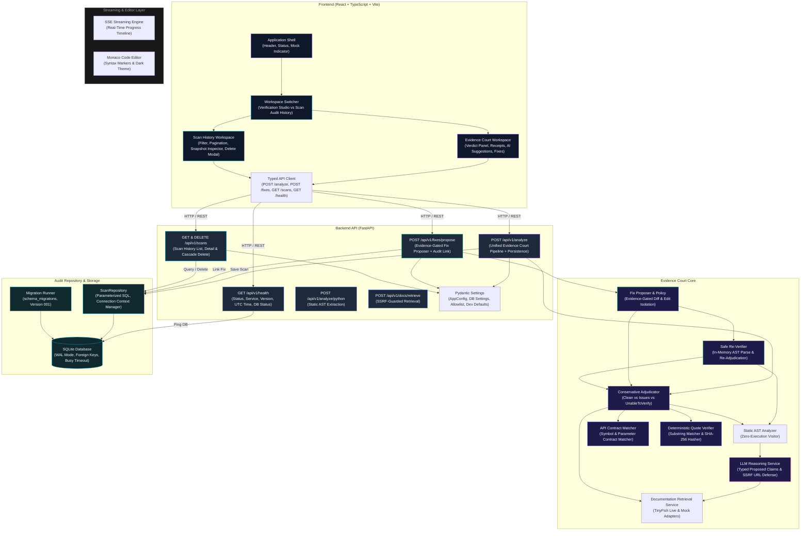

# APICompass v3 — Architecture Overview

## 1. System Architecture

The following diagram outlines the system architecture, highlighting the interaction between client, backend, evidence court engine, and storage layer.

## 2. Architecture Components

### Backend
- **FastAPI Core**: Minimal async ASGI application with lifespan and modular routers.
- **Health Check (`GET /api/v1/health`)**: Returns validated JSON with service name, status, version, and dynamic UTC ISO-8601 timestamp.
- **Static AST Extraction Engine (`POST /api/v1/analyze/python`)**: Zero-execution source code analysis using Python's standard `ast` library.
  - Implemented in `app/services/python_ast_analyzer.py`.
  - Extracts modules, from-imports, symbol aliases, functions, classes, calls, keyword arguments, and heuristic candidates.
  - Identifies relevant literals (HTTP methods, REST endpoints, external URLs, API versions).
  - Handles Python syntax errors with line/column coordinates without crashing.
- **Official Documentation Retrieval Layer (`POST /api/v1/docs/retrieve`)**:
  - Implemented in `app/services/documentation/`.
  - **Source Registry (`registry.py`)**: Canonical Stripe domains with permitted path prefixes.
  - **SSRF Defense (`security.py`)**: Strict HTTPS enforcement, credential stripping, RFC 1918 private IP rejection, loopback/localhost rejection, nonstandard port rejection, homoglyph lookalike defense, and redirect re-validation.
  - **TinyFish Live Adapter (`tinyfish_adapter.py`)**: Connects to TinyFish Fetch & Search APIs with finite timeouts, bounded retries, and credential hygiene.
  - **Deterministic Mock Adapter (`mock_adapter.py`)**: Offline Stripe documentation fixtures clearly labeled with `is_mock: true` and `provider: 'tinyfish_mock'`.
  - **Normalized Evidence Schemas (`app/schemas/documentation.py`)**: Produces structured evidence items with stable IDs, canonical URLs, titles, excerpts, and UTC timestamps.
- **Evidence Court Engine (`POST /api/v1/analyze`)**:
  - Implemented in `app/services/evidence/`.
  - **Deterministic Quote Verifier (`quote_verifier.py`)**: Performs exact and whitespace-normalized substring matching against stored official documentation. Computes SHA-256 content hashes, enforces provenance, and guarantees that quotations are never fabricated or rewritten.
  - **API Contract Matcher (`contract_matcher.py`)**: Correlates AST candidates with retrieved documentation evidence without false inference from omissions. Detects multi-operation ambiguity and enforces required parameter schemas.
  - **Conservative Adjudicator (`adjudicator.py`)**: Coordinates AST analysis, documentation retrieval, contract matching, and quote verification. Emits three deterministic verdicts: `clean`, `issues_found`, and `unable_to_verify`.
  - **Strict Mock Quarantine**: Enforces the integrity rule that mock evidence cannot produce production `clean` or `issues_found` verdicts against user code (returns `unable_to_verify` with reason `MOCK_EVIDENCE_ONLY`).
  - **No Client Trust Elevation**: Public schemas (`AnalysisRequest`) forbid `test_trust_override` with `extra="forbid"`, preventing untrusted clients from claiming live verification.
  - **Conservative Candidate Floor**: Files with zero in-scope API candidates return `unable_to_verify` (`NO_IN_SCOPE_CANDIDATES`), ensuring non-API or unparsed code is never certified clean.
  - **Exact Documentation Host Validation**: Enforces exact host matching against canonical hosts (`docs.stripe.com`, `stripe.com`, `github.com`), completely rejecting `api.stripe.com` and lookalike subdomains (`d0cs.stripe.com`).
- **LLM-Assisted Candidate Reasoning Layer**:
  - Implemented in `app/services/llm/`.
  - **Abstract Provider Interface (`base.py`)**: Defines clean provider protocol `BaseLLMProvider`.
  - **Deterministic Mock Provider (`mock_provider.py`)**: Simulates contextual candidate reasoning offline for Charges, PaymentIntents, and general API calls.
  - **Production OpenAI Provider (`provider.py`)**: Uses OpenAI official SDK with `<UNTRUSTED_USER_CODE>` boundary tags, JSON Schema output structure, and graceful error mapping without leaking secrets.
  - **Reasoning Service Orchestrator (`reasoning_service.py`)**: Enforces input size bounding (`LLM_MAX_CHARS`), authenticates candidate IDs against AST candidates (discarding hallucinated IDs), sanitizes evidence IDs, and runs strict SSRF/allowlist validation against model-suggested documentation URLs.
  - **Integrity Rule**: Proposed claims are strictly extracted into `AISuggestion` objects with `label="AI suggestion — not verified"`. They NEVER override deterministic verdicts, elevate evidence trust, or create verified issues.
- **Evidence-Gated Fix Proposals & Safe Re-Verification**:
  - Implemented in `app/services/fixes/` and `app/api/v1/fixes.py`.
  - **Fix Eligibility Policy (`policy.py`)**: Enforces strict evidence gate conditions before generating any fix proposal. Requires authentic AST candidate ID, approved live official source trust, positive quote verification, complete non-ambiguous contract match, and version applicability. If evidence is offline/mock, strictly abstains with `mock_evidence_only`.
  - **Fix Proposer (`fix_proposer.py`)**:
    - **Independent Server Analysis**: Recomputes analysis authoritatively using backend services; rejects client-supplied verdicts or unverified claims.
    - **Zero Execution & Zero Disk Overwrite**: Operates purely in-memory. Never executes user code or writes to disk.
    - **Bounded Deterministic Transformation**: Targeted line-bounded migration from `stripe.Charge.create` to `stripe.PaymentIntent.create` and `source=` to `payment_method=`.
    - **AST Edit Isolation Verification (`_verify_edit_isolation`)**: Compares original and proposed ASTs outside target lines to guarantee comments, surrounding functions, classes, and logic remain untouched.
    - **Unified Diff Generation**: Generates standard unified diff format (`--- original`, `+++ proposed`) via `difflib.unified_diff`.
    - **In-Memory Static AST Re-Parsing**: Re-parses proposed source code to guarantee valid Python syntax before emitting.
    - **Safe Re-Adjudication**: Re-runs conservative adjudication on proposed code to evaluate verification state (`verified_resolved`, `partially_resolved`, `concern_persists`, `reverification_inconclusive`, `syntax_invalid`, `not_attempted`).
- **SQLite Audit Repository & Scan History Storage**:
  - Implemented in `backend/app/db/` and `backend/app/repositories/scan_repository.py`.
  - **Connection Management (`connection.py`)**: Standard library `sqlite3` context manager, WAL mode (`PRAGMA journal_mode = WAL;`), foreign key cascade enforcement (`PRAGMA foreign_keys = ON;`), busy timeout (`PRAGMA busy_timeout = 5000;`), and automated directory creation.
  - **Safe Versioned Migrations (`migrations.py`)**: Explicit `schema_migrations` tracking table, multi-statement DDL execution, idempotent application, and safe failure on unsupported future schema versions.
  - **Normalized Relational Schema**: Normalized tables `scans`, `scan_evidence`, `scan_findings`, `scan_fix_proposals`, and targeted lookup indexes (`idx_scans_created_at`, `idx_scans_verdict`, `idx_scans_ecosystem`, `idx_evidence_scan`, `idx_findings_scan`, `idx_proposals_scan`).
  - **Privacy Guarantee**: Raw source code is **never** stored in the database by default (`SOURCE_RETENTION_ENABLED=False`). The server authoritatively calculates the SHA-256 source fingerprint and byte length. Analysis requests reject client attempts to enable source retention via `extra="forbid"`.
  - **Exact Stored-Excerpt Hashing**: Evidence excerpt hashes are computed directly on the truncated excerpt text (`ev.content_excerpt[:4000]`), guaranteeing that recomputing `hashlib.sha256(content_excerpt.encode('utf-8')).hexdigest()` matches `content_sha256` exactly.
  - **Deterministic Record Integrity Digest**: SHA-256 canonical digest computed via `compute_record_integrity_hash` over deterministic JSON (`sort_keys=True, separators=(',', ':')`) covering scan ID, timestamp, verdict, summary, source fingerprint, ecosystem, evidence trust, mock flag, sorted checks, sorted verified issues (candidate ID, line, violation type, quote hash), and sorted evidence items (evidence ID, canonical URL, mock flag). Disclaimed as a deterministic audit digest, not a digital signature or blockchain proof.
  - **Server-Side Fix Proposal Linkage Validation**: `ScanRepository.link_fix_proposal` enforces valid proposal ID format (`^prop_[a-zA-Z0-9_\-]{8,64}$`), validates parent `scan_id` existence, and confirms `candidate_id` belongs to the scan's findings before insertion. No proposal marked "applied".
  - **Controlled Startup Failure**: FastAPI lifespan re-raises `MigrationError` and database initialization exceptions as `RuntimeError`, halting startup if future/unsupported schema versions or unwriteable paths are encountered.
  - **History API (`backend/app/api/v1/scans.py`)**:
    - `GET /api/v1/scans`: Bounded pagination (`limit` $\le$ 100), filters (`verdict`, `ecosystem`, `is_mock`), deterministic sort (`created_at DESC, scan_id DESC`), returning summary items with verified issue counts.
    - `GET /api/v1/scans/{scan_id}`: Full audit snapshot marked `is_historical=True`, including reconstructed findings, canonical evidence provenance, and quote verification metadata. Does not re-trigger doc retrieval or LLMs.
    - `DELETE /api/v1/scans/{scan_id}`: Transactional cascade deletion of scan and child evidence, findings, and fix proposal records. Returns 404 for non-existent IDs.
  - **Health Check Integration**: `GET /api/v1/health` probes SQLite connectivity with `SELECT 1;` and reports `database_status="ok"` or `"degraded"`, without leaking database file paths.
  - **Security & Error Sanitization**: All database queries strictly use parameterized queries (`?`), arbitrary database paths via HTTP are blocked, and internal database stack traces are sanitized into clean HTTP 500 error responses.
- **Backend Test Harness**: Comprehensive test suite passing in pytest with 100% pass rate across AST analysis, doc retrieval, evidence court, LLM reasoning, fix proposals, streaming, and audit repository.

### Frontend
- **Vite + React + TypeScript Shell**: Dark developer UI with charcoal/navy tones, violet, cyan, and emerald accents.
- **App Header**: Displays brand, initial Python language badge, Stripe ecosystem badge, and high-visibility Mock Mode indicator.
- **Workspace Navigation Switcher**: Seamless toggle between **Verification Studio** and **Scan Audit History**.
- **Evidence Court Workspace**:
  - Python source code editor with line numbers and preset switchers (Stripe Charge with Legacy Source, Clean PaymentIntent, Syntax Error).
  - **Verdict Panel**: Displays overall verdict (`CLEAN`, `ISSUES FOUND`, `UNABLE TO VERIFY`), trust state, summary, persistent audit record ID badge (`scan_id`), and mock quarantine warning banners.
  - **Verified Issue Details**: Shows source line, contract violation classification, explanation, verified quote receipts with SHA-256 evidence links, and one-click "Propose Fix" action.
  - **Fix Proposal Workspace**:
    - Dedicated "Fix Proposal" tab activated on demand or when proposing a fix.
    - Unified diff viewer highlighting additions (emerald) and deletions (rose) with line markers.
    - Re-verification status badges (`verified_resolved`, `mock_evidence_only`, `partially_resolved`, etc.) with clear explanations.
    - Official evidence receipts and quote verification citations linked to the fix.
    - Caveats and limitations disclosure explicitly stating that runtime behavior is not verified.
    - One-click "Copy Proposed Code" and "Apply Fix to Editor" interactive controls.
    - Mock quarantine warning banners preventing false certainty under offline fixtures.
  - **Scan Audit History Workspace**:
    - Interactive audit history dashboard with filter bar (`All Verdicts`, `Clean`, `Issues Found`, `Unable to Verify`, `Live Official Only`).
    - Bounded pagination with Previous / Next navigation and record counters.
    - Historical audit snapshot inspector viewing verbatim past verdicts, SHA-256 source fingerprints, verified issue receipts, and evidence provenance without re-running scans.
    - Safe delete modal with explicit confirmation for permanent audit record removal.
  - **AI Suggestions Tab**: Displays unverified AI candidate interpretations, claim types, confidence levels, reasoning summaries, and unverified aspect warnings.
  - **Candidate Assessments**: Inspects each static candidate with status (`resolved_clean`, `resolved_issue`, `unresolved`), rationale, empty candidate state, abstention reasons, and contextual "Propose Fix" buttons.
  - **Official Evidence Receipts**: Shows canonical documentation URLs, titles, excerpts, timestamps, provider metadata, and SHA-256 excerpt fingerprint disclaimer.
  - **AST Scope Inspector**: Displays deterministic checks performed and scope limitations.
- **Pipeline Status Panel**: Accurately reflects Static AST Analysis as **Active**, Documentation Retrieval as **Active**, Evidence Court as **Active**, LLM Candidate Reasoning as **Active**, Fix Proposals as **Active**, and SQLite Audit Persistence as **Active**.
- **Status Bar**: Real-time backend connection status indicator (`Connected`, `Connecting`, `Unavailable`), API base URL display, and version sync.

## 3. Adjudication Precedence & Verdict Semantics

1. **Syntax Error**: If code fails AST parsing, immediately return `verdict="unable_to_verify"` with structured syntax error coordinates.
2. **Zero Candidates / Non-API Code**: If AST analysis yields no in-scope API candidates, return `verdict="unable_to_verify"` with `NO_IN_SCOPE_CANDIDATES`. Clean is never awarded to unanalyzed or non-API code.
3. **Unsupported Ecosystem**: If request targets an unsupported ecosystem (e.g. AWS/boto3), return `verdict="unable_to_verify"` with `UNSUPPORTED_ECOSYSTEM`.
4. **Internal Analysis Failure**: If an unexpected exception occurs during AST parsing or contract analysis, catch safely and return `verdict="unable_to_verify"` with `ANALYSIS_FAILURE`.
5. **Mock Quarantine**: If analysis relied on offline mock fixtures, return `verdict="unable_to_verify"` with `MOCK_EVIDENCE_ONLY` and `verified_issues=[]`. Proposed AI claims remain unverified suggestions.
6. **Issues Found**: If at least one contract violation is established by verified official quote receipts against live trusted evidence, return `verdict="issues_found"`. Any candidates without documentation remain explicitly unresolved in `unresolved_candidates`.
7. **Unable to Verify**: If no violation is established but one or more candidates remain unresolved (missing doc, ambiguous operation, incomplete excerpt), return `verdict="unable_to_verify"`.
8. **Clean**: If and only if all analyzed candidates have complete live contract documentation and all contract checks pass under live trust, return `verdict="clean"`.
   > *Note*: A `clean` verdict indicates only that supported checks found no verified contract violations within the analyzed scope. It does not guarantee absence of other bugs.

## 4. Real-Time Streaming & Editor Architecture

### 4.1 Professional Monaco Code Editor (`MonacoPythonEditor.tsx`)
- **Technology**: Built on `@monaco-editor/react` with dynamic loader fallback.
- **Python AST Diagnostics**: Translates static AST parser `SyntaxErrorInfo` directly into Monaco error markers using `monaco.editor.setModelMarkers(model, "apicompass_syntax", [...])`.
- **Zero-Execution Configuration**: Configured with dark theme (`vs-dark`), line numbers, code folding, bracket matching, indentation rules (4 spaces), and automatic layout re-calculation.
- **Stateful Presets**: Interactive buttons reload sample snippets (Charge Legacy, PaymentIntent Clean, Syntax Error, Non-API) into React state while clearing stale error markers.
- **Safe Fix Application**: Fix proposal application updates editor state for review only without automatic file overwrite or code execution.

### 4.2 Real-Time Server-Sent Events (SSE) Streaming Pipeline (`POST /api/v1/analyze/stream`)
- **Transport**: Standard HTTP `text/event-stream` using FastAPI's `StreamingResponse`.
- **Truthful Progress Model**: Asynchronous generator in `StreamAdjudicator` emits discrete, ordered progress stages that truthfully mirror actual work:
  - `accepted` (0%): Request validated and queued.
  - `static_analysis_started` / `completed` (10% - 25%): AST extraction without execution.
  - `ai_reasoning_started` / `completed` (35% - 45%): Optional LLM reasoning (omitted truthfully when disabled).
  - `documentation_retrieval_started` / `completed` (55% - 70%): SSRF-safe documentation retrieval.
  - `evidence_verification_started` / `completed` (80% - 90%): Deterministic quote verification & contract matching.
  - `persistence_started` / `completed` (95% - 98%): SQLite audit record creation.
  - `completed` (100%): Full `AnalysisReport` payload delivered on the wire.
- **Disconnect & Abort Safety**: The streaming generator actively monitors `await raw_request.is_disconnected()`. If a client aborts or disconnects, the generator halts immediately, aborting in-flight tasks and preventing orphaned background work or duplicate persistence.
- **Backward Compatibility**: Synchronous `POST /api/v1/analyze` remains fully operational, reusing the same underlying adjudication logic without breaking legacy clients.

### 4.3 Automated Browser-Level E2E Testing Harness (`@playwright/test`)
- **Browser**: Chromium-only configuration for speed, deterministic execution, and reproducible CI runs.
- **Test Isolation**: Runs against an isolated SQLite test database (`data/test_e2e.db`) with automatic schema initialization and zero developer data contamination.
- **Full Coverage**: 14 end-to-end browser scenarios verifying:
  1. Editor usability, Monaco line numbers, and studio rendering.
  2. Sample preset loading into Monaco DOM.
  3. Real-time streaming progress timeline and stage checkpoints.
  4. Evidence Court report, verdicts, and documentation receipts.
  5. Syntax error handling and zero-execution abstention.
  6. Strict mock evidence quarantine enforcement.
  7. Truthful disabled LLM reporting and heuristic fallbacks.
  8. SQLite scan persistence in audit history view.
  9. Immutable historical audit snapshot loading without re-scanning.
  10. Explicit delete modal confirmation and SQLite record removal.
  11. Fix proposal advisory display and in-memory editor update without execution.
  12. Graceful stream disconnect / network error handling.
  13. Duplicate scan prevention via disabled action button during streaming.
  14. Responsive viewport layout without panel or editor clipping.

